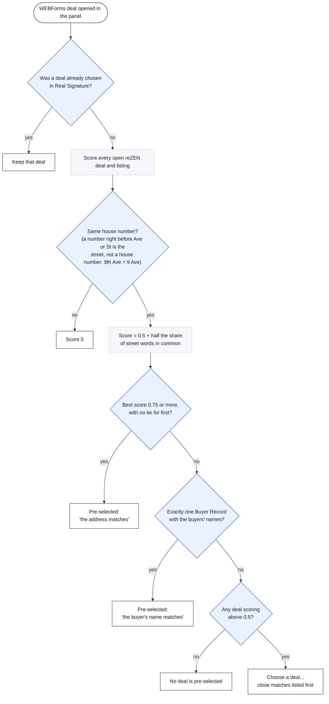
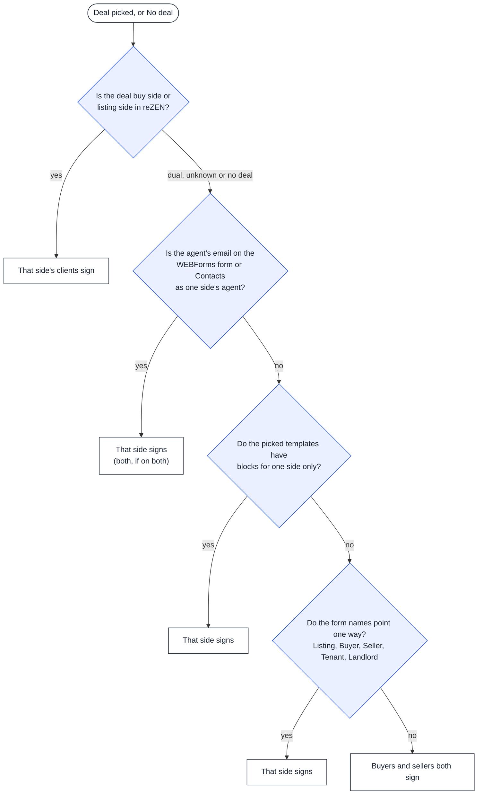
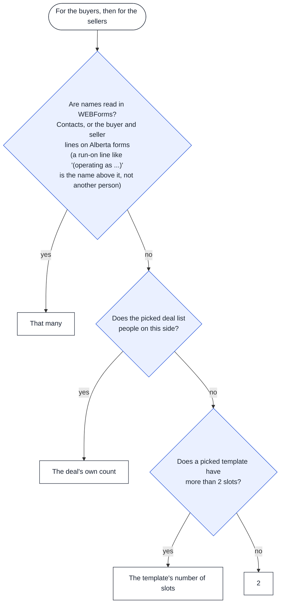
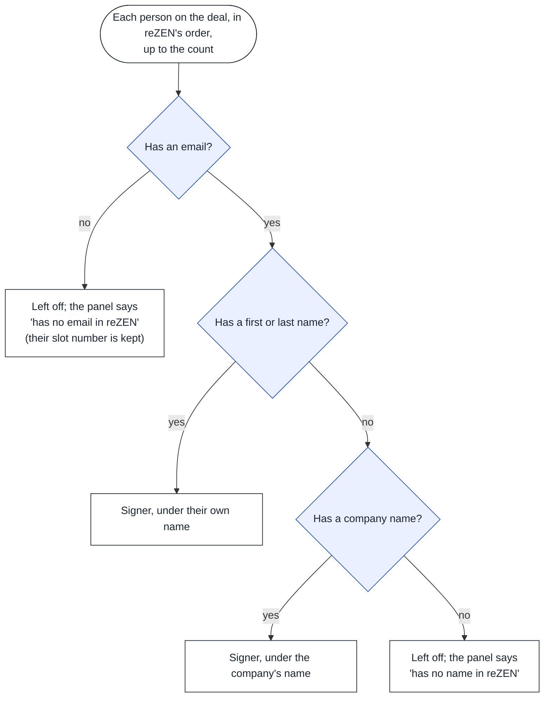

# How the panel decides

What Dotted Line chooses on the Set up screen, in the order it chooses it: which reZEN
deal, which side signs, how many, and who goes in as a signer. The agent can change every
answer in the panel; these are only its starting choices.

Keep this page in step with the code: a change to any of these rules updates its chart in
the same commit (`src/lib/deals.js`, `src/lib/auto.js`, `src/lib/draft.js`).

Blue: a question. Grey: a step. White: what the agent sees.

## 1. Which reZEN deal

Each open deal and listing is scored against the WEBForms address (`addressScore`,
`confidentDeal`). The house number has to match before the street words count.

Example, invented: WEBForms says 120 9 Ave SE. The right deal is "120 9 Avenue Southeast"
and another is "300, 304, 308 9 ave se". The second shares only the avenue's 9, so it
scores 0, and the first is picked.

## 2. Which side signs

Only the agent's own clients sign through them; the other side signs with their own agent
(`signerCounts`).

## 3. How many on the signing side

An empty slot is one click to delete in Real Signature; a missing one means placing its
blocks by hand. So the fallback is 2, but only once nothing better is known
(`signerCounts`; the WEBForms names from `partiesFromContacts` and `partiesFromFormValues`).

## 4. Who goes in as a signer

Real Signature refuses the whole document if any signer has a blank email or name, so
those people are left off and named in the panel (`signeesFromDeal`,
`signersWithoutEmail`). If "Add the agent as a signer" is ticked, the agent chosen is
added after them.

