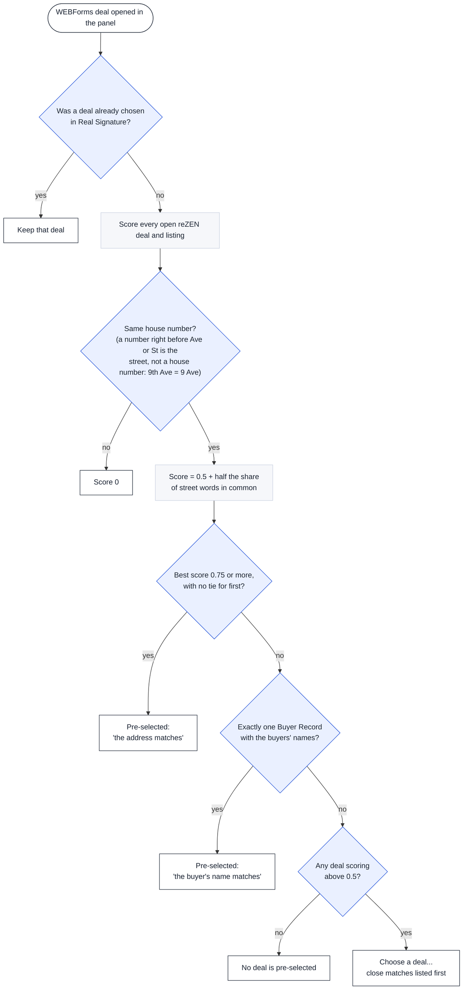
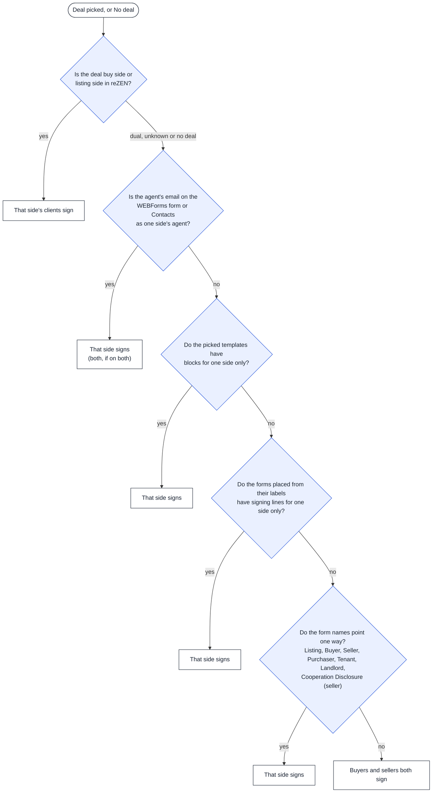
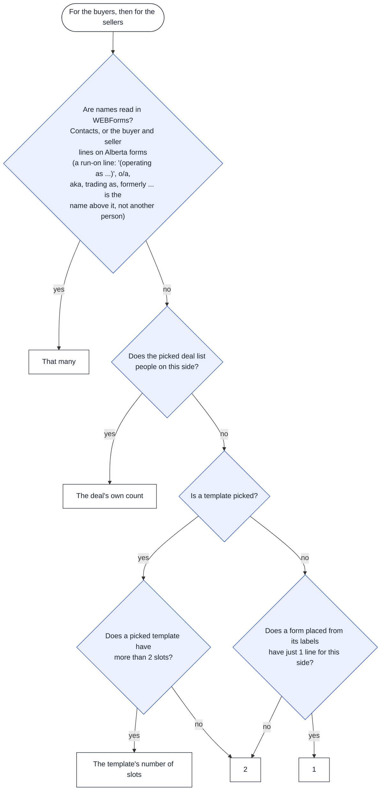
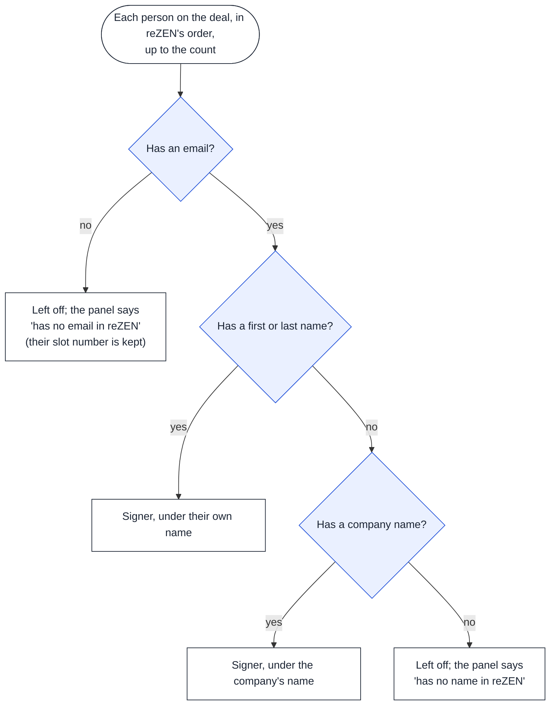

# How the panel decides

What Dotted Line chooses on the Set up screen, in the order it chooses it: which reZEN
deal, which side signs, how many, and who goes in as a signer. The agent can change every
answer in the panel; these are only its starting choices.

Keep this page in step with the code: a change to any of these rules updates its chart in
the same commit (`src/lib/deals.js`, `src/lib/auto.js`, `src/lib/draft.js`).

Blue: a question. Grey: a step. White: what the agent sees.

## 1. Which reZEN deal

Each open deal and listing is scored against the WEBForms address (`addressScore`,
`confidentDeal`). The house number has to match before the street words count.

Example, invented: WEBForms says 120 9 Ave SE. The right deal is "120 9 Avenue Southeast"
and another is "300, 304, 308 9 ave se". The second shares only the avenue's 9, so it
scores 0, and the first is picked.

## 2. Which side signs

Only the agent's own clients sign through them; the other side signs with their own agent
(`signerCounts`).

Placing from a form's own labels never uses the deal to decide a **customer's** side
(Alberta: someone the agent does not represent, on either side). On a customer form the
customer's lines go to the side its title names ("Tenant Customer…" is the buyer slot), and
with no side named they are left for the agent (`formSides`, 2026-11-03).

CREA's national forms sign on a bare "Signed:" line, and the title alone says whose it is:
the seller on the REALTOR® Cooperation Disclosure and Consent Form, the buyer on the
Certificate and Consent of Purchaser. Its "Date:" under it is that signer's. On any other
form a bare "Signed:" is nobody's and nothing is placed (`formSides`, 2026-11-04).

A company client signs by its officer on the "Per: ____ / Authorized Signing Officer(s)"
lines. When every client on the signing side is a company in the reZEN deal (a company
name with no first or last name), Auto place puts their blocks on the Per lines that have
no party heading over them, and leaves the "Seller/Buyer" lines blank. A person, a mix, No
deal or a form without Per lines places as before. Never guessed from "Ltd." in a name
(`companyClients`, 0.4.0). Setting up an uploaded document on Prepare does the same, from
the deal attached on Real Signature's Transaction step; with none attached it places as
for a person.

## 3. How many on the signing side

An empty slot is one click to delete in Real Signature; a missing one means placing its
blocks by hand. So the fallback is 2, but only once nothing better is known
(`signerCounts`; the WEBForms names from `partiesFromContacts` and `partiesFromFormValues`).

Forms placed from their labels count the lines Auto place found when the forms came over
from WEBForms (`placedSummary` slots; a "Client" line counts for whichever side signs).
They settle the side before the form names do, and one line lowers the number to 1. More
lines than 2 never raise it: BC's contracts print three a side as room, not as three
people (Dan, 2026-11-04; 22 of 178 sample forms change, 9 Nov).

When the forms and the picked deal both count a side and differ, the panel says so under
the Buyers and Sellers boxes, with a button to use the other number (`countDisagreements`).
It never switches the number by itself, and a number typed by hand gets no note.

## 4. Who goes in as a signer

Real Signature refuses the whole document if any signer has a blank email or name, so
those people are left off and named in the panel (`signeesFromDeal`,
`signersWithoutEmail`). If "Add the agent as a signer" is ticked, the agent chosen is
added after them.

